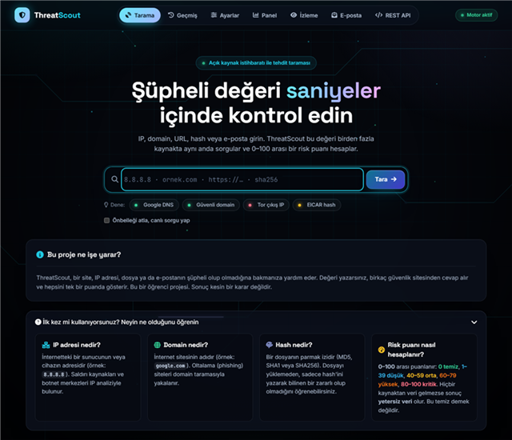

# ThreatScout

ThreatScout, bir site adresi, IP adresi, dosya ya da e-postanın şüpheli olup olmadığına bakmak için yapılmış bir öğrenci projesi.

ThreatScout, bir bağlantıya tıklamadan, bir dosyayı açmadan ya da bir e-postaya cevap vermeden önce hızlıca kontrol etmek için yapıldı. Her siteye tek tek bakmak yerine değeri bir kez yazıyorsunuz. Program birkaç güvenlik servisine sorar ve cevapları 0 ile 100 arasında tek bir puanda gösterir. Puan yükseldikçe risk artar.

Değerin türünü program kendisi anlar: IP, alan adı, link, dosya parmak izi (hash) ya da e-posta. Her servis cevap verdikçe ekrandaki kart dolar. Bir e-postanın gönderenini de kontrol edebilirsiniz. SPF, DKIM ve DMARC gibi kayıtlara bakılarak mesajın gerçekten o alan adından gelip gelmediği anlaşılmaya çalışılır.

Bu bir karar aracı değil, yardımcı bir araçtır. Ücretsiz servislerin anahtarlarıyla çalıştığı için bazı sonuçlar az kaynağa dayanır. Bu durumda ekranda uyarı çıkar. Şüpheli bir şey varsa sonucu tek başına güvenmeyin, başka bir yoldan da doğrulayın.

<table>
  <tr>
    <td align="center"><br><sub>Ana sayfa</sub></td>
    <td align="center"><br><sub>Sonuç ekranı</sub></td>
    <td align="center"><br><sub>E-posta analizi</sub></td>
  </tr>
  <tr>
    <td align="center"><br><sub>Panel</sub></td>
    <td align="center"><br><sub>İzleme listesi</sub></td>
    <td align="center"><br><sub>Giriş animasyonu</sub></td>
  </tr>
</table>

## Kurulum

1. Bilgisayarınızda Python 3.11 veya daha yeni bir sürüm olsun.
2. `threatscout` klasöründe şunları çalıştırın:

```
cd threatscout
python -m venv .venv
.venv\Scripts\activate
pip install -e ".[dev]"
```

3. `.env.example` dosyasının kopyasını alın ve adını `.env` yapın.
4. `.env` dosyasına servislerin anahtarlarını yazın. Anahtarı olmayan servis kapalı kalır. Bu bir hata değildir.

Anahtar alınabilecek servisler: VirusTotal, AbuseIPDB, Shodan, AlienVault OTX, URLhaus (abuse.ch) ve GreyNoise. crt.sh anahtar istemez.

## Çalıştırma

En kolayı `baslat.bat` dosyasına çift tıklamak. Tarayıcı açılır: http://127.0.0.1:8000

Terminalden de tarama yapabilirsiniz:

```
threatscout scan 8.8.8.8
threatscout batch liste.txt -d reports
```

## REST API

Başka programların ThreatScout'a soru sorması için vardır. Web sayfasını kullanıyorsanız gerekmez.

Önce Ayarlar sayfasından bir anahtar oluşturun. Sonra isteğe `X-API-Key` başlığı olarak ekleyin:

```
curl.exe -H "X-API-Key: ANAHTARIN" http://127.0.0.1:8000/api/v1/enrich/ip/8.8.8.8
```

Bütün adresler sunucu çalışırken `http://127.0.0.1:8000/docs` sayfasında yazıyor.

## Doğruluk

Sonuçların ne kadar doğru olduğu [doğruluk raporunda](docs/dogruluk-raporu.md) yazıyor. Bilinen kötü dosyalar kritik çıkıyor, bilinen temiz siteler temiz çıkıyor. Ücretsiz anahtarlarla çoğu sonuç az kaynaktan geliyor.

## Notlar

- `.env` dosyasını kimseyle paylaşmayın ve GitHub'a yüklemeyin.
- Sayfa parolasız açılır. Bu yüzden programı yalnızca kendi bilgisayarınızda çalıştırın.
- Ücretsiz servislerin dakikalık ve günlük istek sınırları var.
- Shodan ücretsiz planda bazı sorgulara izin vermiyor.
- E-posta analizi yalnızca başlığa ve DNS kayıtlarına bakar. Mesajın içini ya da ekin içini açmaz.

## Testler

`threatscout` klasöründe sanal ortamı açıp `python -m pytest` yazın. Testler internete bağlanmadan çalışır.
