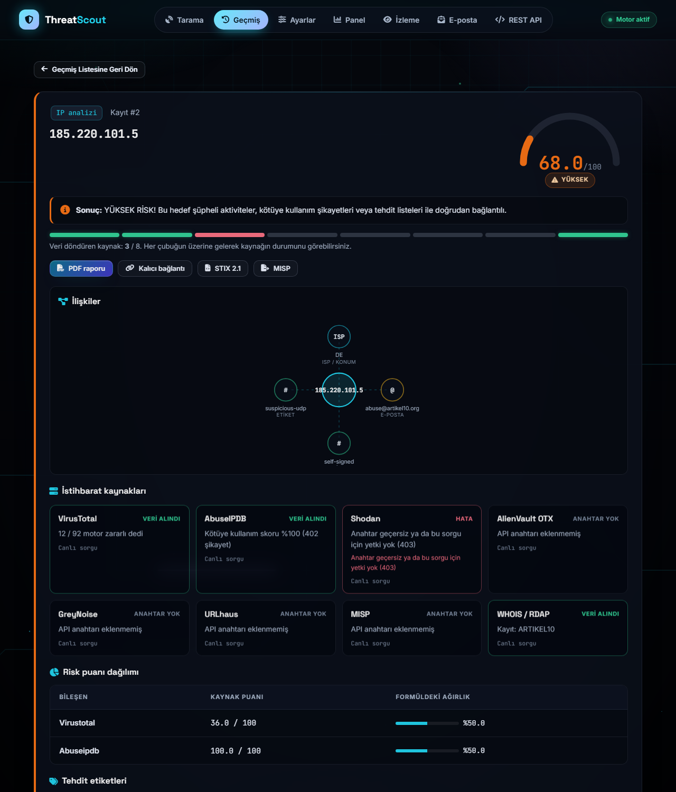
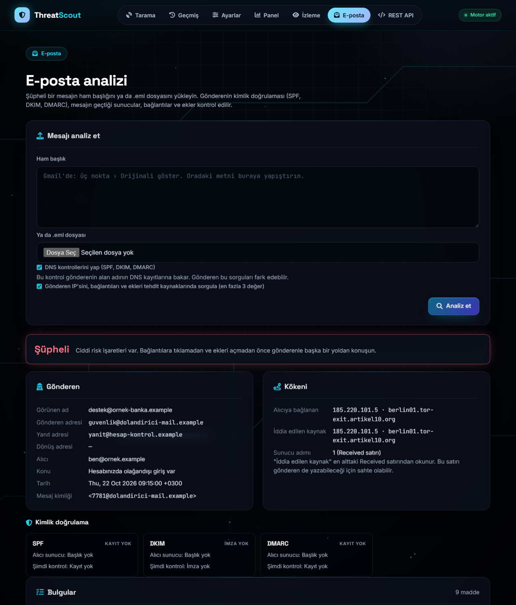
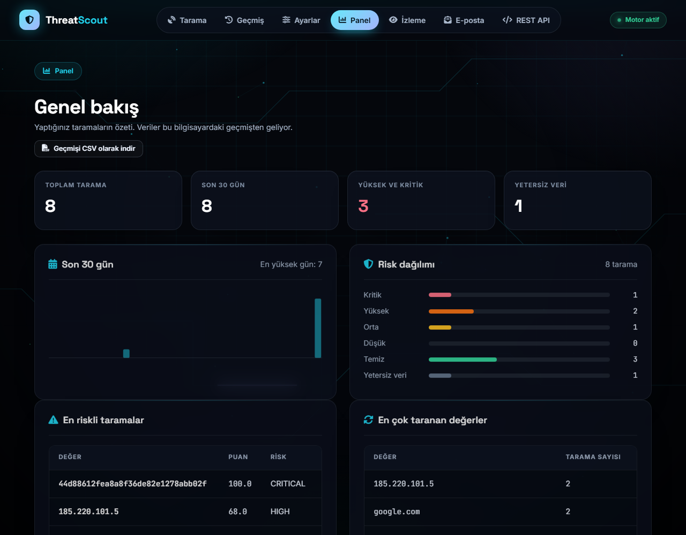
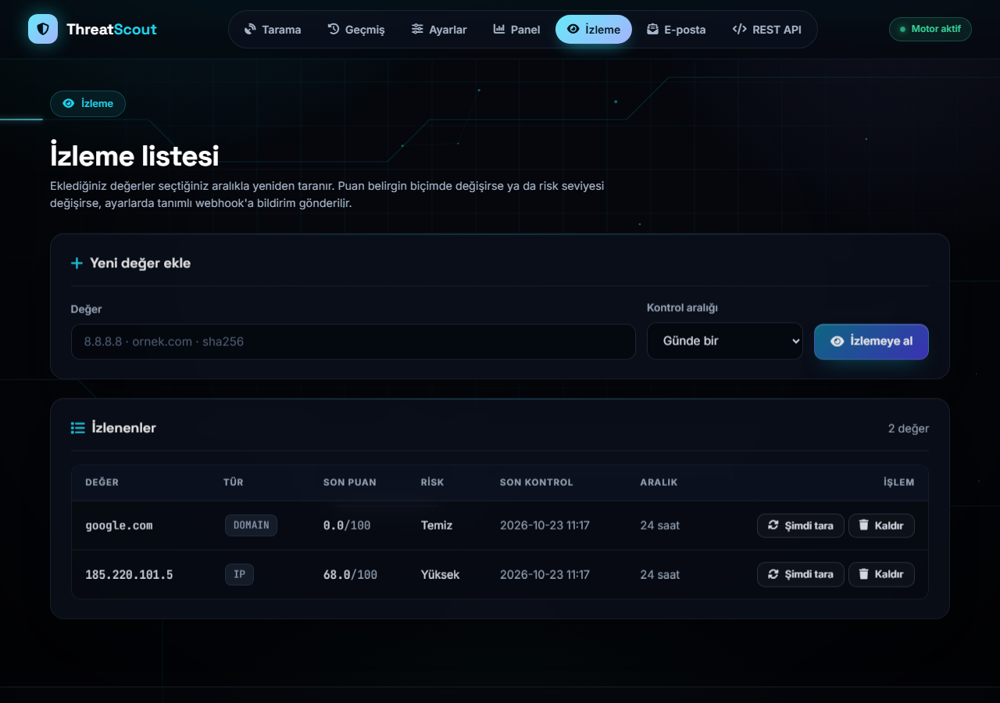
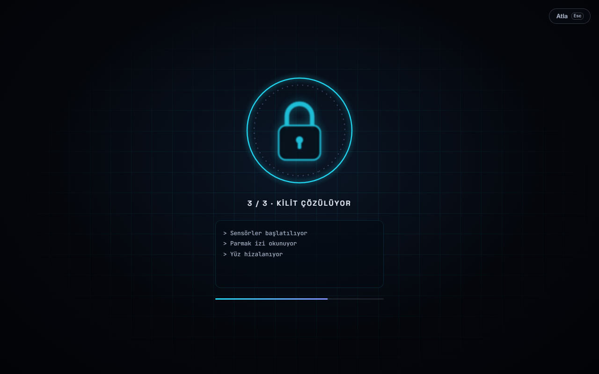

# ThreatScout

ThreatScout, şüpheli bir IP adresini, site adını (domain), linki, dosya hash'ini ya da e-postayı birkaç güvenlik servisinde aynı anda kontrol eden küçük bir programdır.

Girdiğin değerin türünü kendisi tanır. Sonra VirusTotal, AbuseIPDB, Shodan gibi servislere sorar ve 0-100 arası bir risk puanı verir. Sonuçlar, her servis cevap verdikçe ekrana gelir.



## Neler yapabilir?

- Tek bir değeri web sayfasından ya da terminalden taramak
- Listeyi toplu taramak (en fazla 50 satır)
- E-posta başlığını analiz etmek: SPF, DKIM ve DMARC kontrolü, mesajın geçtiği sunucular, bağlantılar ve ekler
- Değerleri izleme listesine alıp belirli aralıklarla yeniden taratmak
- Son 30 günün taramalarını panelde görmek
- Alan adının sertifika geçmişini ve alt alan adlarını görmek (crt.sh)
- Sonucu PDF, HTML ya da JSON olarak kaydetmek
- Sonucu STIX 2.1, MISP ya da CSV olarak dışa aktarmak
- Geçmiş taramaları veritabanında saklamak
- Kendi programlarından kullanmak için bir REST API (aşağıda anlatıldı)

## Ekran görüntüleri

**E-posta analizi.** Görünen adı başka bir adresi taklit eden, ekinde çalıştırılabilir dosya olan bir örnek mesaj. Sonuç "Şüpheli".



**Panel.** Son 30 günün taramaları ve risk dağılımı.



**İzleme listesi.** Seçtiğin değerler belirli aralıklarla yeniden taranır.



**Giriş animasyonu.** Uygulama her açılışta kısa bir giriş animasyonu gösterir. "Atla" ya da Esc ile geçebilirsin.



## REST API nedir, gerekli mi?

REST API, ThreatScout'a başka programlardan soru sormanın bir yoludur. Mesela bir Python betiği ya da bir izleme aracı, bir IP adresinin risk puanını ThreatScout'tan otomatik olarak alabilir.

Gerekli değil. Web sayfasını ya da terminal komutlarını kullanıyorsan REST API'ye hiç ihtiyacın olmaz. Sadece kendi programlarından otomatik sorgu yapmak istediğinde işe yarar.

Kullanmak için:

1. Ayarlar sayfasından bir API anahtarı oluştur (ya da `.env` dosyasına `APP_API_KEY` yaz).
2. İsteğe `X-API-Key` başlığı olarak bu anahtarı ekle.

Windows'ta bir örnek:

```
curl.exe -H "X-API-Key: ANAHTARIN" http://127.0.0.1:8000/api/v1/enrich/ip/8.8.8.8
```

Başlıca adresler:

| Adres | Ne yapar |
|---|---|
| `/api/v1/enrich/ip/{ip}` | IP adresini sorgular |
| `/api/v1/enrich/{deger}` | IP, domain, URL, hash ya da e-posta adresini sorgular |
| `/api/v1/history` | Geçmiş taramaları listeler |
| `/api/v1/history/{id}/stix` | Bir taramayı STIX 2.1 olarak verir |
| `/api/v1/history/{id}/misp` | Bir taramayı MISP olayı olarak verir |
| `/api/v1/history.csv` | Geçmişi CSV olarak verir |

Bütün adresleri ve nasıl kullanılacağını, sunucu çalışırken http://127.0.0.1:8000/docs adresinde görebilirsin.

## Kurulum

1. Bilgisayarında Python 3.11 veya daha yeni bir sürüm olsun.
2. `threatscout` klasörünün içinde sanal ortam oluştur ve kütüphaneleri kur:

   ```
   cd threatscout
   python -m venv .venv
   .venv\Scripts\activate
   pip install -e ".[dev]"
   ```

3. `threatscout` klasöründeki `.env.example` dosyasının kopyasını al ve adını `.env` yap.
4. `.env` dosyasını açıp kendi API anahtarlarını yaz. Anahtarı olmayan servis kapalı kalır, bu bir hata değil.

Anahtarları VirusTotal, AbuseIPDB, Shodan, AlienVault OTX ve GreyNoise sitelerinden ücretsiz alabilirsin. URLhaus için abuse.ch anahtarı gerekebilir. crt.sh için anahtar gerekmez.

## Çalıştırma

- En kolayı: ana klasördeki `baslat.bat` dosyasına çift tıkla. Tarayıcı kendiliğinden açılır: http://127.0.0.1:8000
- Terminalden taramak istersen:

  ```
  threatscout scan 8.8.8.8
  threatscout scan ornek.com --format html -o rapor.html
  threatscout batch liste.txt -d reports
  ```

## Testler

Sanal ortamı açıp `threatscout` klasöründe `python -m pytest` yaz. Testler internete bağlanmadan çalışır.

## Doğruluk

Sonuçların ne kadar doğru olduğunu [doğruluk raporunda](docs/dogruluk-raporu.md) anlattım. Kısaca: bilinen kötü hash'ler kritik çıkıyor, bilinen temiz siteler temiz çıkıyor. Ama ücretsiz anahtarlarla çoğu sonuç az kaynaktan geliyor. Az kaynakla verilen "temiz" sonuçta ekranda uyarı çıkar.

## Güvenlik notları

- `.env` dosyası API anahtarlarını taşır. Bu dosyayı kimseyle paylaşma ve GitHub'a yükleme. `.gitignore` dosyası bunu zaten engelliyor.
- `WEB_PASSWORD` boşsa web sayfası parolasız açılır. Bu yüzden programı sadece kendi bilgisayarında kullan.
- E-posta analizindeki "DNS kontrolleri" seçeneği, gönderenin alan adının DNS kayıtlarına bakar. Gönderen bu sorguları fark edebilir.

## Bilinen eksikler

- Ücretsiz API'lerin dakikalık ve günlük limitleri var. Çok fazla tarama yaparsan "limit doldu" hatası görebilirsin.
- Shodan alan adı sorgularında ücretli plan gerekebilir. O zaman o kaynak "Hata" olarak görünür.
- E-posta analizi yalnızca başlığa ve DNS kayıtlarına bakar. Mesajın içeriğini ya da ekin içini açmaz. Kesin hüküm değil, yardımcı bir kontroldür.
- PDF raporda Türkçe harflerin bazıları (ş, ğ, ı, İ) benzer harflerle yazılır.
